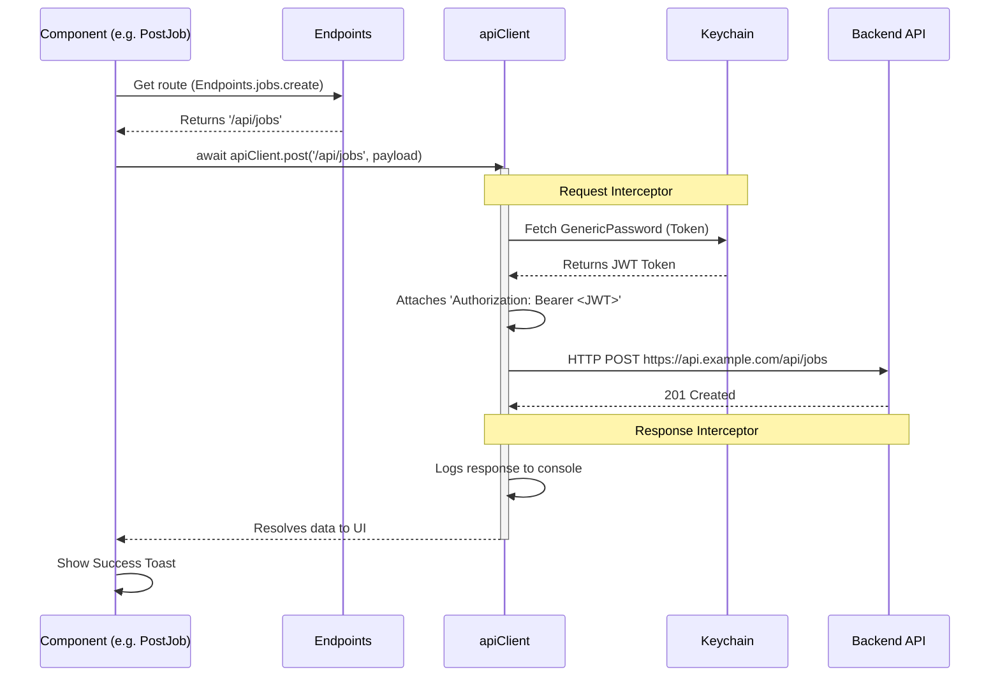

# API Management in AcraPath

This document explains the architecture of how network requests are managed in the AcraPath React Native frontend. We use a centralized configuration pattern to ensure security, consistency, and easy debugging.

## Architecture Overview

We separate our API management into two core files:
1. **`EndPoint.ts`**: A registry of all backend route paths.
2. **`apiClient.ts`**: A global Axios instance that handles authentication, base URLs, and logging.

### Flow Diagram

The following Mermaid sequence diagram illustrates the lifecycle of a network request (e.g., creating a Job Post). GitHub automatically renders this diagram:



---

## 1. Endpoints (`src/app/lib/EndPoint.ts`)

Instead of hardcoding strings like `'/api/auth/login'` inside individual components, we store all paths in a single centralized object. 

**Benefits:**
- **Refactoring:** If the backend changes a route, you only update it in one place.
- **IntelliSense:** TypeScript provides autocomplete for API paths, preventing typos.
- **Dynamic Paths:** Can use functions to handle dynamic URL parameters cleanly.

```typescript
export const Endpoints = {
  auth: {
    login: '/api/auth/login',
    register: '/api/auth/register',
  },
  jobs: {
    create: '/api/jobs',
    getAll: '/api/jobs',
    getById: (id: string) => `/api/jobs/${id}`, // Dynamic URL handling
  },
};
```

---

## 2. Global Client (`src/app/lib/apiClient.ts`)

We create a single `axios` instance called `apiClient`. This instance is configured with Interceptors.

### Request Interceptor
Before the request leaves the app, the interceptor automatically:
1. Fetches the secure JWT token from `react-native-keychain`.
2. Attaches it to the `Authorization` header as a Bearer token.
3. Injects dynamic variables (like Ngrok bypass headers).

### Response Interceptor
When a response comes back (or an error occurs), the interceptor:
1. Provides highly readable console logging for easy debugging.
2. Formats errors so the UI doesn't have to write repetitive `error.response?.data` logic everywhere.
3. Centralizes logic like auto-logout on `401 Unauthorized` errors.

---

## 3. Usage in Components

By combining these two patterns, making an authenticated API call inside a UI component becomes a single, clean line of code.

```typescript
import { Endpoints } from '../app/lib/EndPoint';
import { apiClient } from '../app/lib/apiClient';

const submitJob = async () => {
    try {
      const payload = { company_name: "AcraPath", job_title: "Engineer" };
      
      // Clean, authenticated, and fully typed request!
      await apiClient.post(Endpoints.jobs.create, payload);
      
      ToastAndroid.show('Success!', ToastAndroid.SHORT);
    } catch (error) {
      ToastAndroid.show('Failed.', ToastAndroid.SHORT);
    }
};
```
